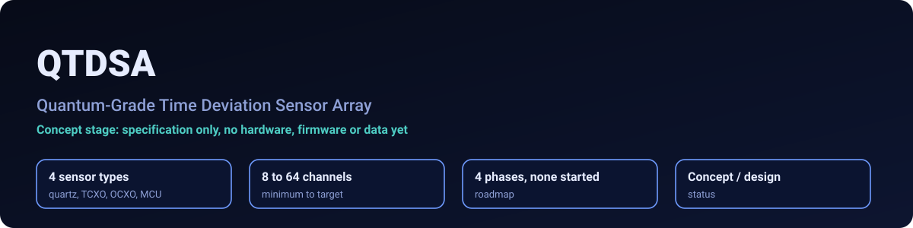
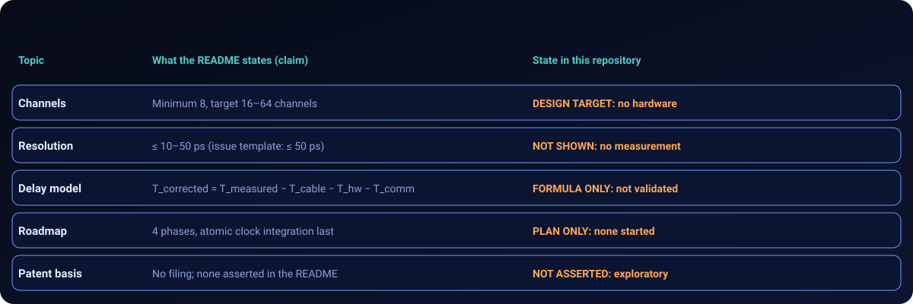
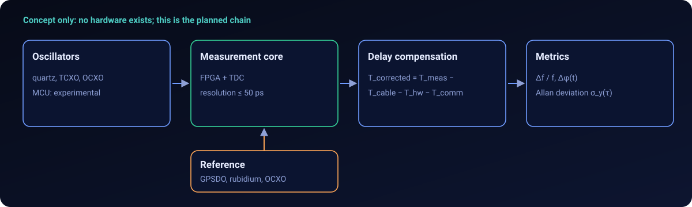

**English** · [Русский](README.ru.md)

# QTDSA — Quantum-Grade Time Deviation Sensor Array

**Advanced multi-channel system for ultra-precise measurement of time and frequency deviations using heterogeneous oscillator arrays**

-blue)

**Part of Advanced Scientific Research Projects (ASRP) Ecosystem**

> **Reading guide.** Badges and numbers describe the design, not measurements. Nothing here is a validated result.
> Numbers are design targets and specification values unless a page says otherwise; see [Claimed vs shown](#claimed-vs-shown).

---

> **If this work is valuable to you — support us.** 7 patron tiers from Principal Philanthropist to Individual Contributor.
>
> **Support:** <https://asrp.tech/en/patrons>
> **Investment inquiries:** _pending — provide URL when available_

---

## Quick navigation

| | Section | Status | Full page |
|---|---|---|---|
| 🧭 | [Overview](#overview) | What is measured and how, why it exists | Concept defined | [guide/STUDY.md](guide/STUDY.md) |
| 🔬 | [Claimed vs shown](#claimed-vs-shown) | Each claim, its source line, its state; open questions | Read this first | [guide/EVIDENCE.md](guide/EVIDENCE.md) |
| ⚙️ | [Technical specification](#technical-specification) | Architecture, sensors, measurement core, delay model | Defined, no hardware built | [guide/DESIGN.md](guide/DESIGN.md) |
| 🗺️ | [Roadmap](#roadmap) | Four phases | 0 of 4 started | [guide/DESIGN.md](guide/DESIGN.md#roadmap) |
| 📁 | [Structure](#structure) | Planned repository layout | Planned, not created | [guide/DESIGN.md](guide/DESIGN.md#planned-structure) |
| 🧩 | [Issue templates](#issue-templates) | Reference task for the measurement core | Defined | [guide/DESIGN.md](guide/DESIGN.md#issue-template) |
| 👥 | [Research team](#research-team) | Contributors | Not yet published | [guide/STUDY.md](guide/STUDY.md#research-team) |
| 🔒 | [Security](#security) | Data classification levels | Standard, applies | [guide/ECOSYSTEM.md](guide/ECOSYSTEM.md#data-classification) |
| 📜 | [Patent connection](#patent-connection) | IP basis, if any | No QTDSA filing | [guide/ECOSYSTEM.md](guide/ECOSYSTEM.md#patent-connection) |
| 🌐 | [ASRP ecosystem](#asrp-ecosystem) | Sibling repositories and patent applications | Current | [guide/ECOSYSTEM.md](guide/ECOSYSTEM.md) |
| ✉️ | [Contact](#contact) | Organization contact | Current | [guide/ECOSYSTEM.md](guide/ECOSYSTEM.md#contact) |

---

## Overview

QTDSA is a hardware, firmware and software concept for a multi-channel system. It infers time deviation
indirectly: it measures phase and frequency instability across a heterogeneous array of independent
oscillators (quartz, TCXO, OCXO and experimental MCU-based clocks), compensates for cable, hardware and
communication delays, and visualizes the result at high resolution.

**Key principle:** the system does not measure time directly. It measures phase, frequency and their
fluctuations, and infers time deviation from them. **This system is not a clock — it is a detector of instability.**

Full page: [guide/STUDY.md](guide/STUDY.md) (what the study is, why it exists, what it depends on).

## Claimed vs shown

**Status: concept / design stage.** This repository defines the specification, the architecture and the
roadmap only. No hardware has been built, no firmware written and no measurement data collected. The
table below separates what the README states from what the repository shows.

Full page: [guide/EVIDENCE.md](guide/EVIDENCE.md) (every row with its source line, and the open questions).

## Technical specification

The specification covers thirteen areas: system concept, architecture, sensor array, measurement core,
reference system, delay compensation, communication, software, UI, environmental factors, experimental modes,
hardware blocks and limitations. Headline values: a minimum of 8 channels with a 16–64 channel target;
a resolution of 10–50 ps; quartz resonators from 32 kHz to 50 MHz; an FPGA measurement core with a TDC.
MCU clocks are experimental and only an auxiliary channel.

Full page: [guide/DESIGN.md](guide/DESIGN.md).

## Roadmap

Four phases: 4–8 channels; 16+ channels with delay compensation; a distributed system; atomic clock
integration. **None of the four phases has started.**

Full page: [guide/DESIGN.md](guide/DESIGN.md#roadmap).

## Structure

The repository holds only this `README.md` today (`git ls-tree -r --name-only HEAD` returns only `README.md`).
The layout below (hardware, firmware, software, docs) is the **planned** structure referenced by the
specification. It is not created yet.

Full page: [guide/DESIGN.md](guide/DESIGN.md#planned-structure).

## Issue templates

The reference task asks for a multi-channel measurement core: at least 8 channels, phase resolution of 50 ps
or better, synchronous acquisition and integration with a reference clock.

Full page: [guide/DESIGN.md](guide/DESIGN.md#issue-template).

## Research team

The team roster is not published in this repository. It is left for the owner to fill in rather than invented.

Full page: [guide/STUDY.md](guide/STUDY.md#research-team).

## Security

The specification defines four data classification levels (PUBLIC, RESEARCH, RESTRICTED, INTERNAL). It does not
say which level applies to this README; that is an open question.

Full page: [guide/ECOSYSTEM.md](guide/ECOSYSTEM.md#data-classification).

## Patent connection

**No QTDSA patent application exists.** The study is exploratory and does not tie to any existing ASRP Kazpatent
filing. The patent applications listed for the ecosystem are context only, and **an application is not a granted patent**.

Full page: [guide/ECOSYSTEM.md](guide/ECOSYSTEM.md#patent-connection).

## ASRP ecosystem

Six related research repositories (three hyperbolic-field studies, ASRP.art, a UAP study and PLFM RADAR) and four
patent applications, listed for context. Neither list is a dependency of QTDSA.

Full page: [guide/ECOSYSTEM.md](guide/ECOSYSTEM.md).

## Open questions

The inconsistencies found inside this repository (channel minimum, resolution wording, security level, planned
files, ecosystem IDs) are listed without being fixed in the source.

Full page: [guide/EVIDENCE.md](guide/EVIDENCE.md#open-questions).

## Contact

Organization: Advanced Scientific Research Projects LLP (Republic of Kazakhstan). Website: [asrp.tech](https://asrp.tech).
Email: info@asrp.tech.

Full page: [guide/ECOSYSTEM.md](guide/ECOSYSTEM.md#contact).

---

**Last Updated:** July 2026

**Status:** Concept and technical specification defined; no hardware built, no firmware written, no measurement
data collected yet.

---

## Navigation index

[Overview](#overview) · [Claimed vs shown](#claimed-vs-shown) · [Technical specification](#technical-specification) · [Roadmap](#roadmap) · [Structure](#structure) · [Issue templates](#issue-templates) · [Team](#research-team) · [Security](#security) · [Patent connection](#patent-connection) · [ASRP ecosystem](#asrp-ecosystem) · [Open questions](#open-questions) · [Contact](#contact)

Archived pre-restructure README: [archive/README_2026-11-19_pre-showcase.md](archive/README_2026-11-19_pre-showcase.md).
