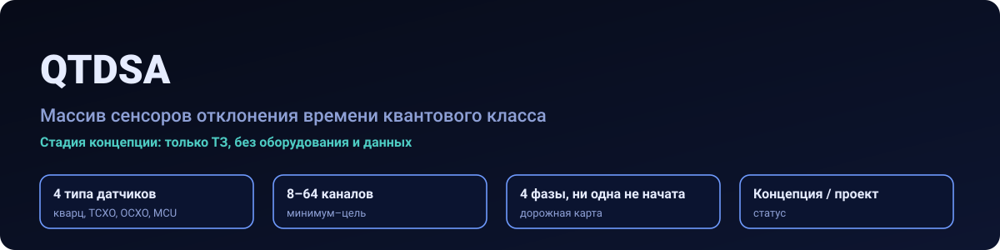
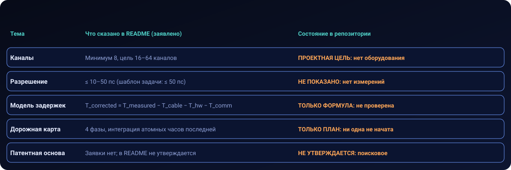
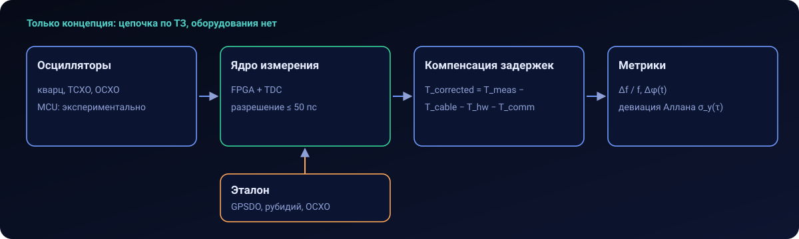

[English](README.md) · **Русский**

# QTDSA — Массив сенсоров отклонения времени квантового класса

**Многоканальная система сверхточного измерения отклонений времени и частоты на основе массива гетерогенных осцилляторов**

-blue)

**Часть Экосистемы ASRP**

> **Как читать.** Значки и числа описывают проект, а не измерения. Ничто здесь не является проверенным результатом.
> Числа — проектные цели и значения технического задания, если страница не говорит иного; см. [Заявлено и показано](#заявлено-и-показано).

---

> **Если эта работа вам полезна — поддержите нас.** 7 уровней меценатства — от Главного Филантропа до Индивидуального Вкладчика.
>
> **Поддержать:** <https://asrp.tech/en/patrons>
> **Инвестиционные запросы:** _в ожидании — добавляется при предоставлении_

---

## Быстрая навигация

| | Section | Status | Full page |
|---|---|---|---|
| 🧭 | [Обзор](#обзор) | Что измеряется и как; зачем это | Концепция определена | [guide/STUDY.ru.md](guide/STUDY.ru.md) |
| 🔬 | [Заявлено и показано](#заявлено-и-показано) | Каждое утверждение, строка-источник, состояние; открытые вопросы | Читать первым | [guide/EVIDENCE.ru.md](guide/EVIDENCE.ru.md) |
| ⚙️ | [Техническое задание](#техническое-задание) | Архитектура, датчики, ядро измерения, модель задержек | Определено, оборудование не построено | [guide/DESIGN.ru.md](guide/DESIGN.ru.md) |
| 🗺️ | [Дорожная карта](#дорожная-карта) | Четыре фазы | 0 из 4 начато | [guide/DESIGN.ru.md](guide/DESIGN.ru.md#дорожная-карта) |
| 📁 | [Структура](#структура) | Планируемая структура репозитория | Запланировано, не создано | [guide/DESIGN.ru.md](guide/DESIGN.ru.md#планируемая-структура) |
| 🧩 | [Шаблоны задач](#шаблоны-задач) | Референсная задача для ядра измерения | Определено | [guide/DESIGN.ru.md](guide/DESIGN.ru.md#шаблон-задачи) |
| 👥 | [Команда](#команда) | Участники | Пока не опубликовано | [guide/STUDY.ru.md](guide/STUDY.ru.md#команда) |
| 🔒 | [Безопасность](#безопасность) | Уровни классификации данных | Стандартно, применяется | [guide/ECOSYSTEM.ru.md](guide/ECOSYSTEM.ru.md#классификация-данных) |
| 📜 | [Связь с патентом](#связь-с-патентом) | Патентная основа, если есть | Заявки по QTDSA нет | [guide/ECOSYSTEM.ru.md](guide/ECOSYSTEM.ru.md#связь-с-патентом) |
| 🌐 | [Экосистема ASRP](#экосистема-asrp) | Смежные репозитории и заявки | Актуально | [guide/ECOSYSTEM.ru.md](guide/ECOSYSTEM.ru.md) |
| ✉️ | [Контакты](#контакты) | Контакты организации | Актуально | [guide/ECOSYSTEM.ru.md](guide/ECOSYSTEM.ru.md#контакты) |

---

## Обзор

QTDSA — это аппаратно-программная концепция многоканальной системы. Она определяет отклонение времени не напрямую,
а через нестабильность фазы и частоты между гетерогенным массивом независимых осцилляторов (кварц, TCXO, OCXO и
экспериментальные MCU-часы), компенсирует задержки кабелей, аппаратуры и связи и визуализирует результат с высоким разрешением.

**Ключевой принцип:** система не измеряет время напрямую. Она измеряет фазу, частоту и их флуктуации и выводит из них
отклонение времени. **Это не часы — это детектор нестабильности.**

Полная страница: [guide/STUDY.ru.md](guide/STUDY.ru.md) (что это за исследование, зачем, от чего зависит).

## Заявлено и показано

**Статус: концепция / стадия проектирования.** Репозиторий задаёт только техническое задание, архитектуру и дорожную
карту. Оборудование не построено, прошивка не написана, измерительные данные не собраны. Таблица ниже отделяет то,
что написано в README, от того, что показывает репозиторий.

Полная страница: [guide/EVIDENCE.ru.md](guide/EVIDENCE.ru.md) (каждая строка с источником и открытые вопросы).

## Техническое задание

Задание охватывает тринадцать областей: концепция системы, архитектура, массив датчиков, ядро измерения, эталон,
компенсация задержек, связь, программное обеспечение, интерфейс, внешние факторы, экспериментальные режимы,
аппаратные блоки и ограничения. Ключевые значения: минимум 8 каналов при цели 16–64 канала; разрешение 10–50 пс;
кварцевые резонаторы от 32 кГц до 50 МГц; ядро измерения на FPGA с TDC. MCU-часы экспериментальны и служат только
вспомогательным каналом.

Полная страница: [guide/DESIGN.ru.md](guide/DESIGN.ru.md).

## Дорожная карта

Четыре фазы: 4–8 каналов; 16+ каналов с компенсацией задержек; распределённая система; интеграция атомных часов.
**Ни одна из четырёх фаз ещё не начата.**

Полная страница: [guide/DESIGN.ru.md](guide/DESIGN.ru.md#дорожная-карта).

## Структура

Сейчас в репозитории есть только этот `README.md` (`git ls-tree -r --name-only HEAD` возвращает только `README.md`).
Структура ниже (hardware, firmware, software, docs) — **планируемая**, на неё ссылается техническое задание. Она ещё не создана.

Полная страница: [guide/DESIGN.ru.md](guide/DESIGN.ru.md#планируемая-структура).

## Шаблоны задач

Референсная задача — многоканальное ядро измерения: не менее 8 каналов, разрешение фазы 50 пс или лучше,
синхронная обработка и интеграция с эталонным тактовым сигналом.

Полная страница: [guide/DESIGN.ru.md](guide/DESIGN.ru.md#шаблон-задачи).

## Команда

Состав команды в этом репозитории не опубликован. Он оставлен для заполнения владельцем, а не выдуман.

Полная страница: [guide/STUDY.ru.md](guide/STUDY.ru.md#команда).

## Безопасность

Техническое задание определяет четыре уровня классификации данных (PUBLIC, RESEARCH, RESTRICTED, INTERNAL). Не сказано,
какой уровень относится к этому README; это открытый вопрос.

Полная страница: [guide/ECOSYSTEM.ru.md](guide/ECOSYSTEM.ru.md#классификация-данных).

## Связь с патентом

**Заявки на патент QTDSA нет.** Исследование поисковое. QTDSA не привязана ни к одной существующей патентной заявке
ASRP (Kazpatent). Патентные заявки, перечисленные для экосистемы, приведены только как контекст, и **заявка — это не выданный патент**.

Полная страница: [guide/ECOSYSTEM.ru.md](guide/ECOSYSTEM.ru.md#связь-с-патентом).

## Экосистема ASRP

Шесть смежных исследовательских репозиториев (три исследования гиперболического поля, ASRP.art, исследование НЛО и
PLFM RADAR) и четыре патентные заявки приведены для контекста. Ни один из списков не является зависимостью QTDSA.

Полная страница: [guide/ECOSYSTEM.ru.md](guide/ECOSYSTEM.ru.md).

## Открытые вопросы

Противоречия внутри этого репозитория (минимум каналов, формулировка разрешения, уровень безопасности, планируемые файлы,
идентификаторы экосистемы) перечислены без исправления в исходных файлах.

Полная страница: [guide/EVIDENCE.ru.md](guide/EVIDENCE.ru.md#открытые-вопросы).

## Контакты

Организация: Товарищество с ограниченной ответственностью «Перспективные Научно-Исследовательские Разработки» / Advanced
Scientific Research Projects LLP (Республика Казахстан). Веб-сайт: [asrp.tech](https://asrp.tech).
Email: info@asrp.tech.

Полная страница: [guide/ECOSYSTEM.ru.md](guide/ECOSYSTEM.ru.md#контакты).

---

**Последнее обновление:** July 2026

**Статус:** Концепция и техническое задание определены; оборудование не построено, прошивка не написана, измерительные
данные не собраны.

---

## Навигационный индекс

[Обзор](#обзор) · [Заявлено и показано](#заявлено-и-показано) · [Техническое задание](#техническое-задание) · [Дорожная карта](#дорожная-карта) · [Структура](#структура) · [Шаблоны задач](#шаблоны-задач) · [Команда](#команда) · [Безопасность](#безопасность) · [Связь с патентом](#связь-с-патентом) · [Экосистема ASRP](#экосистема-asrp) · [Открытые вопросы](#открытые-вопросы) · [Контакты](#контакты)

Архивная версия README до реструктуризации: [archive/README_2026-11-19_pre-showcase.md](archive/README_2026-11-19_pre-showcase.md).
