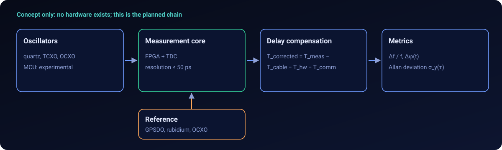

**English** · [Русский](DESIGN.ru.md)

← [Back to README](../README.md)

# Technical specification

Every value on this page is a design value from the README unless it says otherwise. No value is measured.
Source lines refer to [the archived README](../archive/README_2026-11-19_pre-showcase.md), byte-identical to the
pre-restructure `README.md`.



## 1. System concept

Time deviation is inferred from phase and frequency instability across multiple independent oscillators.
The system measures phase, frequency and their fluctuations; it does not read time directly (archive line 68).

## 2. Architecture

- Sensor layer
- Measurement core
- Reference system
- Delay compensation
- Software and UI

## 3. Sensor array

**Supported sensors:**

- Quartz resonators, 32 kHz to 50 MHz
- TCXO
- OCXO
- MCU-based clocks: experimental

> **Limitation:** an MCU is not a precise time source. It is used only as an auxiliary channel.

**Topology:**

- Minimum: 8 channels
- Target: 16–64 channels
- Distributed sensor support

## 4. Measurement core

- FPGA (required)
- TDC (time-to-digital converter)
- Resolution: ≤ 10–50 ps (design target)
- Synchronous multi-channel processing

## 5. Reference system

- GPSDO
- Rubidium standard
- OCXO (fallback)

## 6. Delay compensation

Model:

```
T_corrected = T_measured − T_cable − T_hw − T_comm
```

Sources of delay: cables, connectors, FPGA latency, communication. The model is a formula in the specification
and has not been validated.

## 7. Communication

- USB-C
- Ethernet
- Wi-Fi and Bluetooth: user interface only

## 8. Software

**Features:** phase plots, frequency drift, channel comparison, data logging.

**Metrics:** Δf / f, Δφ(t), Allan deviation σ_y(τ).

## 9. UI

Scientific style, overlay plots, scale down to nanoseconds, dark mode.

## 10. Environmental factors

Temperature, vibration, electromagnetic fields.

## 11. Experimental modes

- Differential mode
- Reference mode
- Distributed mode

## 12. Hardware blocks

- Sensor boards
- FPGA core
- Reference module
- Power system

## 13. Limitations

- Quartz is not absolute time. An MCU is not a precision time source. A wireless link is not precise measurement.

## Roadmap

| Phase | Scope |
|---|---|
| Phase 1 | 4–8 channels |
| Phase 2 | 16+ channels and delay compensation |
| Phase 3 | Distributed system |
| Phase 4 | Atomic clock integration |

**None of these phases have started yet.** The phases are a plan, not a schedule.

## Planned structure

The README states that the repository holds only `README.md` today, and that the tree below is the planned layout
referenced by the specification. Nothing below exists yet; `metadata.yaml` is not created.

```
ASRP_Quantum-Grade_Time_Deviation_Sensor_Array-QTDSA/   (planned)
├── README.md                    # currently the only file
├── metadata.yaml                # not yet created
├── hardware/
│   ├── sensor_boards/
│   ├── fpga_core/
│   └── reference_clock/
├── firmware/
│   ├── fpga/
│   └── mcu/
├── software/
│   ├── backend/
│   └── ui/
└── docs/
    ├── architecture.md
    ├── calibration.md
    └── experiments.md
```

## Issue template

**Title:** Implement Multi-Channel Time Deviation Measurement Core

**Description:** Develop FPGA-based measurement core capable of detecting phase and frequency differences across
multiple oscillator channels with picosecond-level resolution.

**Requirements:**

- Support ≥ 8 channels
- Phase resolution ≤ 50 ps
- Synchronous acquisition
- Integration with reference clock

**Tasks:**

- Design TDC module
- Implement phase comparator
- Add calibration routine
- Validate with identical signal input

The Russian version of the template in the README uses the same requirements.
