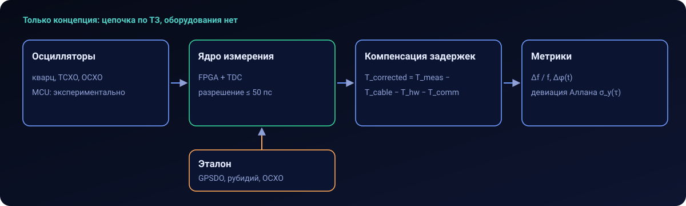

[English](DESIGN.md) · **Русский**

← [Назад к README](../README.ru.md)

# Техническое задание

Каждое значение на этой странице — проектное значение из README, если не сказано иное. Ни одно значение не измерено.
Номера строк относятся к [архивной версии README](../archive/README_2026-11-19_pre-showcase.md), побайтно совпадающей с `README.md` до реструктуризации.



## 1. Концепция системы

Отклонение времени определяется через анализ нестабильности фазы и частоты между несколькими независимыми осцилляторами.
Система измеряет фазу, частоту и их флуктуации; время напрямую она не читает (строка архива 68).

## 2. Архитектура

- Слой датчиков
- Измерительное ядро
- Эталон
- Компенсация задержек
- Программное обеспечение и интерфейс

## 3. Массив датчиков

**Поддерживаемые датчики:**

- Кварцевые резонаторы, 32 кГц – 50 МГц
- TCXO
- OCXO
- MCU-часы: экспериментально

> **Ограничение:** MCU не является точным источником времени. Используется только как вспомогательный канал.

**Топология:**

- Минимум: 8 каналов
- Цель: 16–64 каналов
- Поддержка распределённых датчиков

## 4. Измерительное ядро

- FPGA (обязательно)
- TDC (преобразователь время-код)
- Разрешение: ≤ 10–50 пс (проектная цель)
- Синхронная обработка каналов

## 5. Эталон

- GPSDO
- Рубидиевый эталон
- OCXO (резерв)

## 6. Компенсация задержек

Модель:

```
T_corrected = T_measured − T_cable − T_hw − T_comm
```

Источники задержек: кабели, разъёмы, задержка FPGA, связь. Модель — формула в техническом задании и не проверена.

## 7. Связь

- USB-C
- Ethernet
- Wi-Fi и Bluetooth: только интерфейс

## 8. Программное обеспечение

**Возможности:** графики фазы, частотный дрейф, сравнение каналов, запись данных.

**Метрики:** Δf / f, Δφ(t), девиация Аллана σ_y(τ).

## 9. Интерфейс

Научный стиль, overlay-графики, масштаб до наносекунд, тёмная тема.

## 10. Внешние факторы

Температура, вибрации, электромагнитные поля.

## 11. Экспериментальные режимы

- Дифференциальный режим
- Эталонный режим
- Распределённый режим

## 12. Аппаратные блоки

- Платы датчиков
- Ядро FPGA
- Эталонный модуль
- Система питания

## 13. Ограничения

- Кварц — не абсолютное время. MCU — не прецизионный источник времени. Беспроводная связь — не точные измерения.

## Дорожная карта

| Фаза | Содержание |
|---|---|
| Фаза 1 | 4–8 каналов |
| Фаза 2 | 16+ каналов и компенсация задержек |
| Фаза 3 | Распределённая система |
| Фаза 4 | Интеграция атомных часов |

**Ни одна из этих фаз ещё не начата.** Фазы — план, а не график.

## Планируемая структура

README указывает, что сейчас в репозитории только `README.md`, а дерево ниже — планируемая структура, на которую ссылается
техническое задание. Ничего из него ещё не существует; `metadata.yaml` не создан.

```
ASRP_Quantum-Grade_Time_Deviation_Sensor_Array-QTDSA/   (планируется)
├── README.md                    # пока единственный файл
├── metadata.yaml                # ещё не создан
├── hardware/
│   ├── sensor_boards/
│   ├── fpga_core/
│   └── reference_clock/
├── firmware/
│   ├── fpga/
│   └── mcu/
├── software/
│   ├── backend/
│   └── ui/
└── docs/
    ├── architecture.md
    ├── calibration.md
    └── experiments.md
```

## Шаблон задачи

**Название:** Реализация многоканального ядра измерения отклонений времени

**Описание:** Разработать FPGA-ядро для измерения фазовых и частотных различий между каналами с разрешением на уровне пикосекунд.

**Требования:**

- ≥ 8 каналов
- Разрешение ≤ 50 пс
- Синхронная обработка
- Интеграция с эталоном

**Задачи:**

- Разработка TDC
- Фазовый компаратор
- Калибровка
- Тестирование на одинаковом сигнале

Английская версия шаблона в README содержит те же требования.
