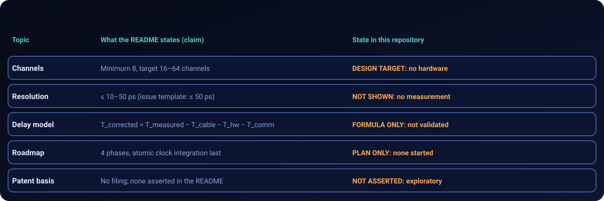

**English** · [Русский](EVIDENCE.ru.md)

← [Back to README](../README.md)

# Claimed vs shown

This page sorts what the repository states into three groups: what it **proves** (the repository's own content),
what it **claims but does not prove**, and what is **not yet done**. Every row names its source line in
[the archived README](../archive/README_2026-11-19_pre-showcase.md) (the same bytes as the repository's `README.md`
at tag `pre-showcase-2026-11`). Nothing here is a measured result.

## Proven by the repository

| Statement | Source |
|---|---|
| At tag `pre-showcase-2026-11` the repository tracked one file, `README.md`; there was no code, data, hardware or firmware file (the showcase later added `guide/`, `tools/`, `tests/`, `archive/`) | `archive/README_2026-11-19_pre-showcase.md:230` |
| The document says that no hardware has been built, no firmware written and no measurement data collected | `archive/README_2026-11-19_pre-showcase.md:63` |
| The title uses the term "Quantum-Grade"; the text does not define it | `archive/README_2026-11-19_pre-showcase.md:1` |
| No QTDSA patent filing exists; the README says the study is exploratory | `archive/README_2026-11-19_pre-showcase.md:333` |
| The principle is phase and frequency instability, not direct time measurement (a description of the concept) | `archive/README_2026-11-19_pre-showcase.md:68` |

## Claimed but not proven

| Claim | Source | What is missing |
|---|---|---|
| Minimum 8 channels, target 16–64 | `archive/README_2026-11-19_pre-showcase.md:126` | Design target; no hardware |
| Resolution 10–50 ps | `archive/README_2026-11-19_pre-showcase.md:134` | No measurement in the repository |
| MCU clocks are experimental and only an auxiliary channel | `archive/README_2026-11-19_pre-showcase.md:121` | Stated limitation; not tested |
| Delay model `T_corrected = T_measured − T_cable − T_hw − T_comm` | `archive/README_2026-11-19_pre-showcase.md:148` | A formula in the specification; not validated |
| Four phases, atomic clock integration last | `archive/README_2026-11-19_pre-showcase.md:221` | Plan only |
| "This system is not a clock — it is a detector of instability." | `archive/README_2026-11-19_pre-showcase.md:71` | Interpretation of the concept |
| Issue template: phase resolution of 50 ps or better | `archive/README_2026-11-19_pre-showcase.md:276` | Requirement, not result |

## Not yet done (the README's own status lines)

| Item | Source |
|---|---|
| Self-declared status: concept and design stage; no hardware, firmware or data | `archive/README_2026-11-19_pre-showcase.md:398` |
| None of the four roadmap phases has started | `archive/README_2026-11-19_pre-showcase.md:223` |
| The planned layout (hardware, firmware, software, docs) is not created | `archive/README_2026-11-19_pre-showcase.md:232` |
| The team roster is not published | `archive/README_2026-11-19_pre-showcase.md:307` |
| The "Last Updated" date is July 2026 | `archive/README_2026-11-19_pre-showcase.md:396` |

## Open questions

These are inconsistencies inside the repository. They are recorded here and **not fixed** in the source.

1. **Minimum channel count.** The specification says a minimum of 8 channels (line 126). Phase 1 of the roadmap
   says 4–8 channels (line 218). The issue template requires at least 8 (line 275). Which minimum is the gate for
   Phase 1?
2. **Resolution wording.** The specification gives "≤ 10–50 ps" (line 134); the issue template gives "≤ 50 ps"
   (line 276). Is 10 ps a target and 50 ps the requirement, or is a range meant?
3. **Atomic clock.** Phase 4 is atomic clock integration (line 221). The reference system lists GPSDO, rubidium and
   OCXO only (lines 139–141). Which reference is intended for Phase 4?
4. **Security level.** Four data classification levels are defined (lines 322–327). None is assigned to this README
   or to any planned file. Which level applies to the public repository?
5. **Planned files.** The planned tree includes `metadata.yaml` and three `docs/` files (lines 243, 258–261). None exists
   and no creation date is given.
6. **Team.** The roster is "TBD" (lines 312–314). Who is responsible for filling it in, and when?
7. **Investment contact.** "Investment inquiries" is marked "pending" (line 29), with no URL.

## How to read the numbers

Channel counts, resolution and the number of roadmap phases on these pages are computed from the README by
`tools/facts.py`. A number here is a design value; it becomes a result only when a measurement is in the repository.
