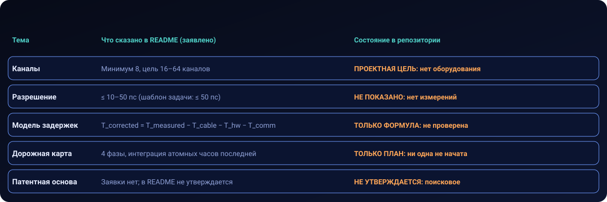

[English](EVIDENCE.md) · **Русский**

← [Назад к README](../README.ru.md)

# Заявлено и показано

Эта страница делит то, что сказано в репозитории, на три группы: что **подтверждено** содержимым самого репозитория,
что **заявлено, но не подтверждено**, и что **ещё не сделано**. У каждой строки указана строка-источник в
[архивной версии README](../archive/README_2026-11-19_pre-showcase.md) (те же байты, что `README.md` репозитория
на теге `pre-showcase-2026-11`). Ничто здесь не является измеренным результатом.

## Подтверждено репозиторием

| Утверждение | Источник |
|---|---|
| В репозитории один файл, `README.md`; нет ни кода, ни данных, ни аппаратуры, ни прошивки | `archive/README_2026-11-19_pre-showcase.md:230` |
| Документ сам говорит, что оборудование не построено, прошивка не написана и измерительные данные не собраны | `archive/README_2026-11-19_pre-showcase.md:63` |
| В заголовке использован термин «Quantum-Grade»; в тексте он не определён | `archive/README_2026-11-19_pre-showcase.md:1` |
| Заявки на патент QTDSA нет; README называет исследование поисковым | `archive/README_2026-11-19_pre-showcase.md:333` |
| Принцип — нестабильность фазы и частоты, а не прямое измерение времени (описание концепции) | `archive/README_2026-11-19_pre-showcase.md:68` |

## Заявлено, но не подтверждено

| Утверждение | Источник | Чего не хватает |
|---|---|---|
| Минимум 8 каналов, цель 16–64 | `archive/README_2026-11-19_pre-showcase.md:126` | Проектная цель; оборудования нет |
| Разрешение 10–50 пс | `archive/README_2026-11-19_pre-showcase.md:134` | Измерений в репозитории нет |
| MCU-часы экспериментальны и служат только вспомогательным каналом | `archive/README_2026-11-19_pre-showcase.md:121` | Заявленное ограничение; не проверено |
| Модель задержек `T_corrected = T_measured − T_cable − T_hw − T_comm` | `archive/README_2026-11-19_pre-showcase.md:148` | Формула в техническом задании; не проверена |
| Четыре фазы, интеграция атомных часов последней | `archive/README_2026-11-19_pre-showcase.md:221` | Только план |
| «Это не часы — это детектор нестабильности.» | `archive/README_2026-11-19_pre-showcase.md:71` | Интерпретация концепции |
| Шаблон задачи: разрешение фазы 50 пс или лучше | `archive/README_2026-11-19_pre-showcase.md:276` | Требование, а не результат |

## Ещё не сделано (статусные строки самого README)

| Пункт | Источник |
|---|---|
| Заявленный статус: концепция и стадия проектирования; нет аппаратуры, прошивки и данных | `archive/README_2026-11-19_pre-showcase.md:398` |
| Ни одна из четырёх фаз дорожной карты не начата | `archive/README_2026-11-19_pre-showcase.md:223` |
| Планируемая структура (hardware, firmware, software, docs) не создана | `archive/README_2026-11-19_pre-showcase.md:232` |
| Состав команды не опубликован | `archive/README_2026-11-19_pre-showcase.md:307` |
| Дата «Last Updated» — July 2026 | `archive/README_2026-11-19_pre-showcase.md:396` |

## Открытые вопросы

Это противоречия внутри репозитория. Они записаны здесь и **не исправлены** в исходных файлах.

1. **Минимум каналов.** Техническое задание: минимум 8 каналов (строка 126). Фаза 1 дорожной карты: 4–8 каналов
   (строка 218). Шаблон задачи: не менее 8 (строка 275). Какой минимум является условием для Фазы 1?
2. **Формулировка разрешения.** Техническое задание: «≤ 10–50 пс» (строка 134); шаблон задачи: «≤ 50 пс»
   (строка 276). 10 пс — это цель, а 50 пс — требование, или имеется в виду диапазон?
3. **Атомные часы.** Фаза 4 — интеграция атомных часов (строка 221). Эталонная система перечисляет только GPSDO,
   рубидий и OCXO (строки 139–141). Какой эталон предназначен для Фазы 4?
4. **Уровень безопасности.** Определены четыре уровня классификации данных (строки 322–327). Ни один не назначен этому
   README или какому-либо планируемому файлу. Какой уровень относится к публичному репозиторию?
5. **Планируемые файлы.** В планируемом дереве есть `metadata.yaml` и три файла в `docs/` (строки 243, 258–261).
   Ни один не существует, дата создания не указана.
6. **Команда.** Состав — «TBD» (строки 312–314). Кто отвечает за заполнение и когда?
7. **Контакт для инвестиций.** «Инвестиционные запросы» помечены «в ожидании» (строка 29), URL не указан.
8. **Патентные ID экосистемы (сверка вне репозитория).** README указывает ASRP.art как «KZ 2025/0592.1 + PCT»
   (строка 377), а ASRP.drift как «KZ 413554» (строка 378). Реестр идентификаторов asrp.memory фиксирует другое
   состояние: PCT-заявка считается изъятой с 2026-05-12, а KZ 413554 — входящий номер, регистрационный номер 2026/0347.1
   (`materials/identifiers.md` в asrp.memory, строки 183–184). Эти статусы здесь не проверены и могли измениться.
9. **Срок по патентной заявке экосистемы (сверка вне репозитория).** Тот же реестр фиксирует запрос ведомства по
   2026/0347.1 с окончательным сроком ответа 2026-08-18 и без записанного результата (`materials/identifiers.md:69`).
   Текущий статус на 2026-11-19 неизвестен и здесь не решается.
10. **PLFM RADAR (сверка вне репозитория).** README перечисляет PLFM RADAR в связанных исследовательских репозиториях
    (строка 361). Реестр asrp.memory считает его внешним открытым форком, а не исследованием ASRP. README этого не говорит.

## Как читать числа

Количество каналов, разрешение и число фаз дорожной карты на этих страницах вычисляются из README скриптом
`tools/facts.py`. Число здесь — проектное значение; оно становится результатом только тогда, когда в репозитории есть измерение.
